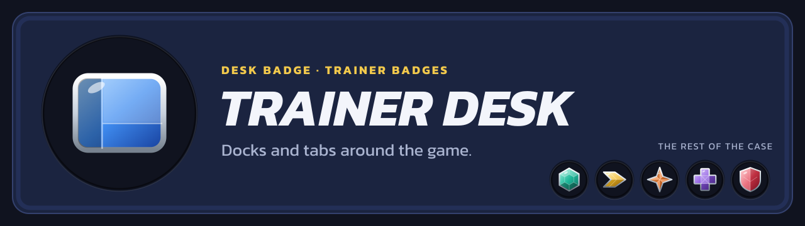
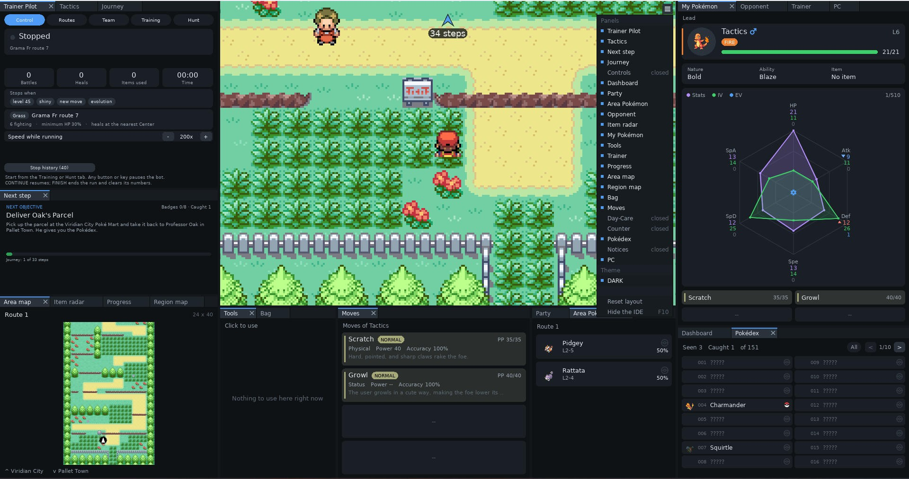
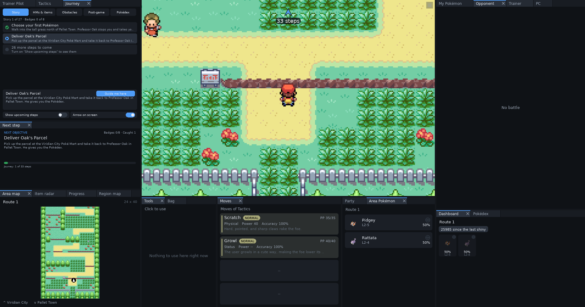
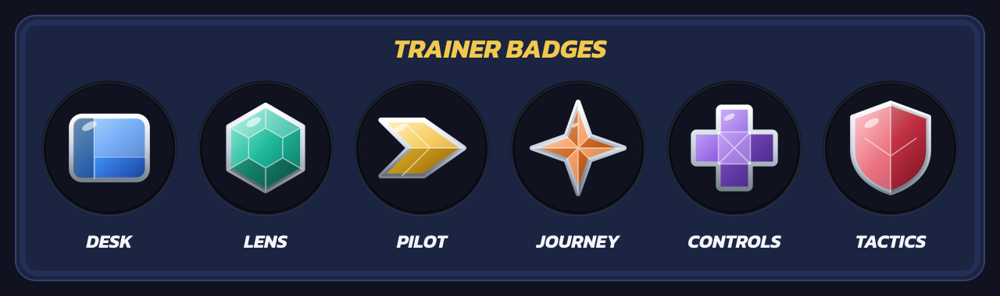
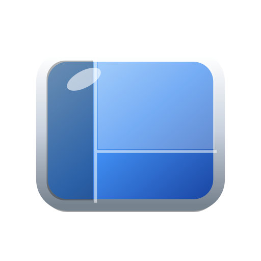

# Trainer Desk

An IDE-style layout for Gen1Recomp: the game keeps the middle of the window, and panels supplied by other mods sit in docks around it, with tabs, draggable dividers and their own desktop windows.





Built for Pokémon FireRed/LeafGreen on Gen1Recomp (mod API 3). Trainer Desk has no panels of its own; it hosts the ones other mods register, such as Trainer Lens and Trainer Pilot.

## Features

- Left, right and bottom docks, each holding tabbed groups of panels.
- Drag a tab to move a panel to another dock or group; drag a divider to resize.
- Tabs that do not fit in a bar go into a menu at the end of the bar.
- Any panel can be taken out into its own desktop window and put back.
- **F10** hides every dock so the game has the whole window, and brings them back (the key can be changed in the mod's options).
- The mouse wheel over a panel goes to that panel; over the game it is still the game's zoom.
- A menu in the corner of the game area shows or closes panels, picks a theme and restores the default layout.
- The picture a mod sends to the second screen (for example Kanto Gear in Separate Screens mode) can be docked as a panel.
- The layout, the theme and which panels are closed or floating are remembered between sessions.

## Compatibility

| | |
| --- | --- |
| Games | FireRed and LeafGreen (tested). Declared for every Gen 3 game; Ruby, Sapphire and Emerald not tested yet. |
| Gen1Recomp | 0.3.93 or newer (mod API 3); tested on 0.4.8 |

## Installation

Copy the `trainer_desk` folder into the game's mods folder:

```
%APPDATA%\pokemon-love2d\mods\trainer_desk
```

## Options

| Option | Default | What it does |
| --- | --- | --- |
| IDE layout | on | Turns the docks on or off. |
| Dock second screen | on | Docks the second-screen picture as a panel instead of opening another window. |
| Language | English | Language of the dock's own menu and tooltips: ENGLISH, ESPANOL, PORTUGUES or JAPANESE. |
| Hide/show key | F10 | Key that hides and shows the docks (F10, F9, F8, F6 or none). |
| Reset layout | off | Turn on once to put every panel back in its default place. |

## For mod authors

Other mods reach the dock through `mod.find("trainer_desk").exports.dock`. See [docs/API.md](docs/API.md) for the full interface. A minimal panel:

```lua
local other = mod.find and mod.find("trainer_desk")
local dock = other and other.exports and other.exports.dock
if dock and dock.api == 1 and dock.active() then
  dock.register({
    id = "my_mod.status", title = "Status", width = 320, height = 200,
    responsive = true,
    draw = function(now, w, h)
      love.graphics.print("Hello from my panel", 10, 10)
    end,
  })
end
```

## Languages

The dock's menu and tips are in English, Spanish, Portuguese and Japanese: choose one with the **Language** option in the mod's settings. Names that come from the game itself (Pokémon, moves, items, places) stay in the language of your game.

Each language is a file in `trainer_desk/lang/` (`en.lua`, `es.lua`, `pt.lua`, `ja.lua`); English is the reference, and a text missing from another language shows in English. Japanese text is drawn with a cut-down copy of Noto Sans JP in `trainer_desk/fonts/` (SIL Open Font License, `fonts/OFL.txt`). See [docs/TRANSLATING.md](docs/TRANSLATING.md) to fix or add a translation.

## Documentation

- [docs/GUIDE.md](docs/GUIDE.md): player guide, using the docks.
- [docs/API.md](docs/API.md): the panel and theme interface for other mods.
- [docs/ARCHITECTURE.md](docs/ARCHITECTURE.md): how the files fit together and which engine hooks are used.
- [docs/TRANSLATING.md](docs/TRANSLATING.md): how the translations work and how to change them.
- [docs/PUBLISHING.md](docs/PUBLISHING.md): releases and the Gen1Recomp mod index.
- [CHANGELOG.md](CHANGELOG.md): version history.
- [tests/README.md](tests/README.md): running the automated checks.

## History

Until version 0.4.1 this mod was called PokeDock (id `poke_dock`).

## The Trainer Badges

Six mods for FireRed and LeafGreen that work on their own and better together. Each one is a badge in the same case.



| | Mod | What it does |
| --- | --- | --- |
|  | **Trainer Desk** (this mod) | Docks and tabs around the game. |
|  | [Trainer Lens](https://github.com/MarcoAFSchaefer/trainer-lens) | Everything the game knows, on screen. |
|  | [Trainer Pilot](https://github.com/MarcoAFSchaefer/trainer-pilot) | Trains and hunts while you are away. |
|  | [Trainer Journey](https://github.com/MarcoAFSchaefer/trainer-journey) | Where to go next, without spoilers. |
|  | [Trainer Controls](https://github.com/MarcoAFSchaefer/trainer-controls) | Every button, where you want it. |
|  | [Trainer Tactics](https://github.com/MarcoAFSchaefer/trainer-tactics) | The best play, with the numbers. |

## What it changes in the game

[DIFFERENCES.md](DIFFERENCES.md) lists everything this mod does differently from the unmodded game.

## License

MIT (see LICENSE). The bundled Japanese font is under the SIL Open Font License (`fonts/OFL.txt`).
